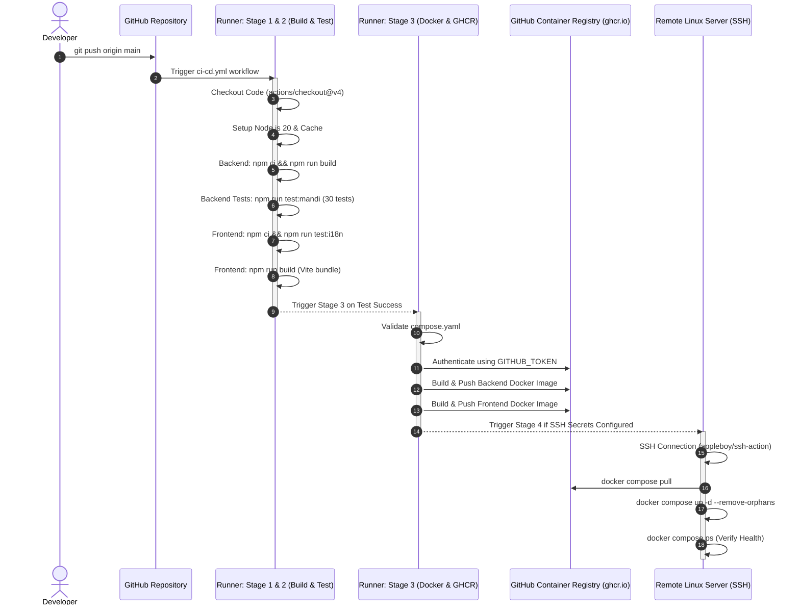

# KisanIQ — B.Tech DevOps Practical Submission Report

**Course**: DevOps Engineering Laboratory  
**Project**: **KisanIQ** (AI-Powered Agricultural Intelligence Platform)  
**Practicals Covered**:
- **Assignment 14**: Docker Compose for a Multi-Container Application (Web + Database)
- **Assignment 15**: Simple CI/CD Pipeline Integrating GitHub, Build Tools, Docker, and Deployment

---

## 📑 Table of Contents
1. [Project Overview & Technology Stack](#1-project-overview--technology-stack)
2. [Assignment 14: Multi-Container Docker Compose Implementation](#2-assignment-14-multi-container-docker-compose-implementation)
   - [2.1 Architecture Diagram](#21-architecture-diagram)
   - [2.2 Service Breakdown](#22-service-breakdown)
   - [2.3 Container Networking & Volume Persistence](#23-container-networking--volume-persistence)
   - [2.4 Service Health Checks & Dependency Chaining](#24-service-health-checks--dependency-chaining)
   - [2.5 Docker Verification Commands](#25-docker-verification-commands)
3. [Assignment 15: CI/CD Pipeline (GitHub Actions + GHCR + SSH Deploy)](#3-assignment-15-cicd-pipeline-github-actions--ghcr--ssh-deploy)
   - [3.1 Pipeline Architecture Flowchart](#31-pipeline-architecture-flowchart)
   - [3.2 Stage-by-Stage Implementation](#32-stage-by-stage-implementation)
   - [3.3 GitHub Secrets & Conditional Deployment](#33-github-secrets--conditional-deployment)
   - [3.4 Security & Zero-Leakage Practices](#34-security--zero-leakage-practices)
4. [Files Created & Modified Reference](#4-files-created--modified-reference)
5. [Viva-Voce & Examination Quick-Reference Q&A](#5-viva-voce--examination-quick-reference-qa)

---

## 1. Project Overview & Technology Stack

**KisanIQ** is a full-stack, AI-powered agricultural intelligence assistant built for Indian farmers. The platform turns raw agricultural data (agronomic weather, soil health cards, APMC mandi rates via CEDA Agmarknet) into actionable daily decisions: *"Aaj mujhe kya karna hai?" / "आज मला काय करायचे आहे?"*.

| Layer | Technology | Container Name | Host Port | Purpose |
|---|---|---|---|---|
| **Frontend** | React 19, Vite 8, Tailwind CSS v4, Nginx Alpine | `kisaniq-frontend` | `5173` & `80` | Client UI & Reverse Proxy |
| **Backend** | Node.js 20, Express, TypeScript 5.7 | `kisaniq-backend` | `8000` | REST API & Agronomic Decision Engine |
| **Database** | PostgreSQL 16 (Alpine) | `kisaniq-db` | `5432` | Relational Storage (25 Tables) |

---

## 2. Assignment 14: Multi-Container Docker Compose Implementation

### 2.1 Architecture Diagram

```mermaid
graph TD
    Client["Browser / Client (Farmer)"]
    subgraph "Docker Host (Bridge Network: kisaniq-network)"
        subgraph "Frontend Container (kisaniq-frontend)"
            Nginx["Nginx Reverse Proxy & Static Host<br/>Port 80 (Mapped to 5173 & 80)"]
            ReactSPA["React 19 Vite Production SPA Bundle"]
        end

        subgraph "Backend Container (kisaniq-backend)"
            ExpressAPI["Node.js + Express API Server<br/>Port 8000"]
            HealthEndpoint["Health Check: /api/health"]
            DecisionEngine["Agronomic Intelligence Engine"]
        end

        subgraph "Database Container (kisaniq-db)"
            Postgres["PostgreSQL 16 Engine<br/>Port 5432"]
            InitSchema["01-schema.sql (Auto-mount)"]
            PgData[("Named Volume:<br/>kisaniq_pgdata")]
        end
    end

    Client -->|HTTP :5173 or :80| Nginx
    Nginx -->|Static Assets /*| ReactSPA
    Nginx -->|Proxy Pass /api/*| ExpressAPI
    Client -.->|Direct API (Optional) :8000| ExpressAPI
    ExpressAPI -->|pg.Pool TCP :5432| Postgres
    Postgres --- PgData
    InitSchema -->|Initial DDL| Postgres
```

### 2.2 Service Breakdown

#### Service 1: PostgreSQL Database (`db`)
- **Image**: `postgres:16-alpine`
- **Environment**:
  - `POSTGRES_DB`: `kisaniq_db`
  - `POSTGRES_USER`: `kisaniq_user`
  - `POSTGRES_PASSWORD`: Configured securely via environment variables (defaulting to safe fallback in `.env.example`).
  - `PGDATA`: `/var/lib/postgresql/data/pgdata`
- **Volume Mount**:
  - `kisaniq_pgdata:/var/lib/postgresql/data` ensures complete data persistence across container restarts or teardowns.
  - `./server/db/schema.sql:/docker-entrypoint-initdb.d/01-schema.sql:ro` runs table creations (25 relational tables) upon initial container boot.
- **Healthcheck**: Executes `pg_isready -U kisaniq_user -d kisaniq_db` every 5 seconds.

#### Service 2: Backend API Server (`backend`)
- **Build**: Multi-stage `server/Dockerfile` (Builder stage compiles TypeScript with `tsc`; Runner stage runs compiled `dist/server.js` with unprivileged `node` user).
- **Environment**:
  - `DATABASE_URL`: `postgresql://kisaniq_user:kisaniq_secure_pass_2026@db:5432/kisaniq_db`
  - Connects to the database service directly using its Docker internal DNS name (`db`).
- **Healthcheck**: Queries `http://127.0.0.1:8000/api/health` using `wget`. The endpoint validates real database connectivity (`SELECT 1`) before returning HTTP 200.

#### Service 3: Frontend Client (`frontend`)
- **Build**: Multi-stage `frontend/Dockerfile` (Builder stage builds React Vite SPA bundle; Runner stage copies assets to `nginx:alpine`).
- **Nginx Reverse Proxy**:
  - Proxies `/api/` requests internally to `http://backend:8000/api/` — eliminating Cross-Origin Resource Sharing (CORS) complications.
  - Serves static SPA files and routes all fallback paths to `index.html` (`try_files $uri $uri/ /index.html;`).
- **Ports**: Exposes port `80` inside the container, mapped to host ports `5173` and `80`.

### 2.3 Container Networking & Volume Persistence

- **Network**: All three containers belong to `kisaniq-network` (`driver: bridge`). Services discover and talk to each other via container hostnames (`db`, `backend`, `frontend`).
- **Volume**: `kisaniq_pgdata` is a named local volume. All farmer accounts, crop records, soil cards, and mandi price logs persist indefinitely even after `docker compose down`.

### 2.4 Service Health Checks & Dependency Chaining

To prevent race conditions (where backend attempts to connect before PostgreSQL has finished initializing):
1. `backend` configures:
   ```yaml
   depends_on:
     db:
       condition: service_healthy
   ```
2. `frontend` configures:
   ```yaml
   depends_on:
     backend:
       condition: service_healthy
   ```

### 2.5 Docker Verification Commands

```bash
# 1. Validate Docker Compose syntax
docker compose config

# 2. Build multi-stage images
docker compose build

# 3. Start containers in detached mode
docker compose up -d

# 4. Inspect container statuses and health
docker compose ps

# 5. Inspect database logs
docker compose logs db

# 6. Verify backend database connectivity
curl -s http://localhost:8000/api/health

# 7. Access Frontend in browser
# Open: http://localhost:5173 or http://localhost:80

# 8. Stop containers while preserving database volume
docker compose down
```

---

## 3. Assignment 15: CI/CD Pipeline (GitHub Actions + GHCR + SSH Deploy)

### 3.1 Pipeline Architecture Flowchart



### 3.2 Stage-by-Stage Implementation

The pipeline is defined in `.github/workflows/ci-cd.yml`:

#### STAGE 1: Source
- Triggers on:
  - `push` to branch `main`
  - `pull_request` to branch `main`
  - `workflow_dispatch` (manual trigger)
- Checks out complete repository with Git history using `actions/checkout@v4`.

#### STAGE 2: Build & Test
- Environment: `ubuntu-latest` with `node-version: 20` and npm dependency caching.
- **Backend Verification**:
  - `npm ci` installs pinned dependencies.
  - `npm run build` compiles TypeScript to `dist/`.
  - `npm run test:mandi` runs 30 automated unit & regression tests validating date normalization, price range filters, CEDA Agmarknet provider parsing, geodesic mandi routing, and selling decision logic.
- **Frontend Verification**:
  - `npm ci` installs React dependencies.
  - `npm run test:i18n` runs key parity check across English (`en`), Hindi (`hi`), and Marathi (`mr`).
  - `npm run build` generates production Vite bundle with tree shaking and minification.

#### STAGE 3: Docker Build & Image Publishing
- Validates Docker Compose configuration (`docker compose config`).
- Authenticates against GitHub Container Registry (`ghcr.io`) using the built-in `${{ secrets.GITHUB_TOKEN }}`.
- Builds multi-stage images for both `backend` and `frontend`.
- Tags images with:
  - `latest`
  - `sha-<commit_hash>`
- Publishes images to `ghcr.io/<repository-owner>/kisaniq-backend` and `ghcr.io/<repository-owner>/kisaniq-frontend`.

#### STAGE 4: Automated Remote Server Deployment
- Executes conditionally via SSH (`appleboy/ssh-action@v1.2.0`).
- Runs **only** when all required deployment secrets are present in GitHub repository settings.
- Execution steps:
  1. SSH connection to remote Linux server host.
  2. Navigates to deployment directory (`DEPLOY_PATH`).
  3. Pulls latest container images from GHCR (`docker compose pull`).
  4. Restarts application containers seamlessly (`docker compose up -d --remove-orphans`).
  5. Verifies container health and status (`docker compose ps`).

### 3.3 GitHub Secrets & Conditional Deployment

The deployment job will run safely if and only if the following GitHub Repository Secrets are provided:
- `DEPLOY_HOST`: Remote server public IP or FQDN.
- `DEPLOY_USER`: Remote SSH username (e.g., `ubuntu`).
- `DEPLOY_SSH_KEY`: OpenSSH private key with authorization on the host.
- `DEPLOY_PATH`: Target directory on server (e.g., `/home/ubuntu/kisaniq`).
- `GHCR_USERNAME`: GitHub username or bot account.
- `GHCR_TOKEN`: GitHub Personal Access Token (PAT) with `read:packages` scope.

> **Note**: If remote server secrets are not provided, Stage 1, Stage 2, and Stage 3 complete successfully without failing the pipeline.

### 3.4 Security & Zero-Leakage Practices

1. `.env` and sensitive credentials are listed in `.gitignore` and `.dockerignore`.
2. Password and token references use fallback syntax in `compose.yaml` (`${VARIABLE:-fallback}`) without committing secrets to version control.
3. Containers run under an unprivileged user (`USER node` in backend).
4. GitHub Actions utilizes the ephemeral `GITHUB_TOKEN` with minimum scoped permissions (`contents: read`, `packages: write`).

---

## 4. Files Created & Modified Reference

| File | Status | Description |
|---|---|---|
| `compose.yaml` | Created | Multi-container Docker Compose specification (db + backend + frontend) |
| `docker-compose.yml` | Created | Legacy Compose CLI compatibility mirror |
| `server/Dockerfile` | Created | Multi-stage Node.js/TypeScript backend image with healthcheck |
| `frontend/Dockerfile` | Created | Multi-stage React/Vite/Nginx image with healthcheck |
| `frontend/nginx.conf` | Created | Nginx reverse proxy configuration for static SPA & `/api/` routing |
| `.dockerignore` | Created | Docker build context exclusion rules |
| `server/.dockerignore` | Created | Backend build context exclusion rules |
| `frontend/.dockerignore` | Created | Frontend build context exclusion rules |
| `.github/workflows/ci-cd.yml` | Created | 4-Stage GitHub Actions CI/CD pipeline |
| `.env.example` | Updated | Comprehensive environment variable template with Docker & deploy vars |
| `.gitignore` | Updated | Production ignore rules protecting credentials, databases, and build artifacts |
| `README.md` | Updated | Comprehensive documentation of fullstack application & DevOps setup |
| `DEVOPS-ASSIGNMENT.md` | Created | Academic submission report for Assignment 14 & Assignment 15 |

---

## 5. Viva-Voce & Examination Quick-Reference Q&A

**Q1: What is the purpose of Docker Compose in KisanIQ?**  
*Answer*: Docker Compose orchestrates the three separate services (`db`, `backend`, `frontend`) as a single unit using declarative YAML, automating network creation, port mappings, health dependencies, and persistent volume mounts with a single command (`docker compose up -d`).

**Q2: Why is a multi-stage Dockerfile used for both frontend and backend?**  
*Answer*: Multi-stage builds separate the build environment (which needs compilers, linters, and full node_modules) from the execution environment. This significantly reduces image size, minimizes attack surface, and ensures development dependencies are excluded from production.

**Q3: How does the frontend communicate with the backend in Docker Compose?**  
*Answer*: The frontend container runs an Nginx reverse proxy. When the client browser accesses `http://localhost:5173/api/`, Nginx proxies the request internally over the Docker network to `http://backend:8000/api/`. This avoids CORS errors and exposes a unified endpoint.

**Q4: How does `depends_on` with `condition: service_healthy` prevent database connection crashes?**  
*Answer*: Standard `depends_on` only waits for container creation, not database readiness. By using `condition: service_healthy` linked to `pg_isready`, the backend container does not start until PostgreSQL is fully initialized and accepting socket connections.

**Q5: How does the CI/CD pipeline ensure that failing code never reaches production?**  
*Answer*: Stage 2 runs `npm run build` and `npm run test:mandi` before Docker packaging. If any test fails or TypeScript does not compile, GitHub Actions halts execution immediately, preventing Docker image publishing and remote deployment.
